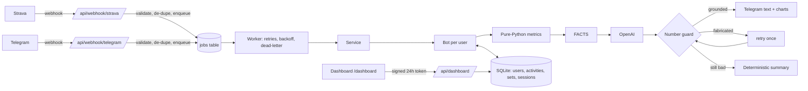

# Architecture

**Request path vs work path.** Webhook handlers do three cheap things (authenticate, de-duplicate, enqueue) and return. All Strava/LLM/Telegram I/O happens in the worker, so a slow LLM never causes Strava to retry.

**Trust boundaries.** Strava and Telegram webhooks are authenticated by verify-token / secret header; the dashboard by an HMAC-signed expiring token; OAuth `state` is signed so a callback can't be forged to link someone else's chat.

**Data isolation.** Workout data is reachable only through `UserDB`, which is constructed with one `user_id` and puts it in every query.

**LLM contract.** The model sees only computed FACTS and may not introduce numbers. `guard.py` enforces this at runtime; `evals/` measures it across prompt/model changes.
